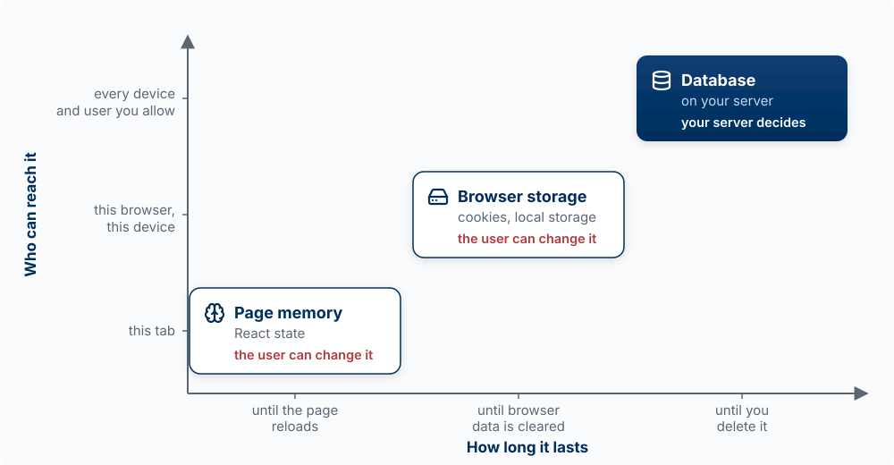
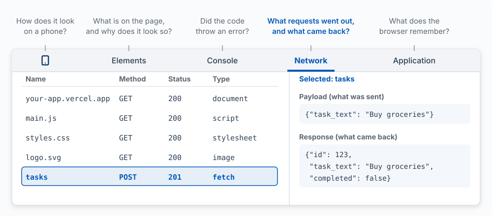

::: {.callout-note}
## What this appendix is

This appendix goes one level below [Anatomy of an Application](07-anatomy-of-an-application.qmd).
It covers what the browser does with the files your app sends, the developer tools built into
every browser, and Claude in Chrome, the extension that lets Claude use your browser the way you
do. It assumes [How a Request Crosses the Internet](07-anatomy-of-an-application.qmd#how-a-request-crosses-the-internet).

The Claude in Chrome sections were checked on October 10, 2026 against
[Use Claude Code with Chrome](https://code.claude.com/docs/en/chrome) and the Claude in Chrome help
articles ([getting started](https://support.claude.com/en/articles/12012173-getting-started-with-claude-in-chrome),
[safety](https://support.claude.com/en/articles/12902428-use-claude-in-chrome-safely),
[permissions](https://support.claude.com/en/articles/12902446-claude-in-chrome-permissions-guide)).
The extension changes often; when this page and the docs disagree, the docs are right.
:::

## What the Browser Does

**The model:** a browser turns three kinds of files into a screen, then keeps listening. It
requests the page and gets back **HTML** (the structure: headings, lists, buttons), **CSS** (the
look: colors, sizes, layout), and **JavaScript** (the behavior: what happens on a click). It builds
the **DOM**, the page as a tree of elements, from the HTML, and draws it on the screen, using the
CSS to style each element. The CSS is not part of the DOM. Then it waits. When the user clicks,
JavaScript runs, and it either changes the DOM, so the screen changes, or sends a new request.

{#fig-url-to-screen fig-alt="Left to right: a URL goes out as requests, and three kinds of files come back: CSS, look; HTML, structure; and JavaScript, behavior, highlighted. An arrow labeled builds runs from HTML to the DOM, and an arrow labeled changes runs from JavaScript to the DOM. The DOM, the page as a tree, is drawn as a small tree: page, with list and button below it, and two tasks under list. An arrow labeled draws runs from the DOM to the screen. The CSS arrow, labeled styles each element, passes over the DOM and goes straight to the screen, a small to-do list with Buy groceries, Call dentist, and an Add button. A loop runs from the Add button back to JavaScript, labeled a click, an event, runs JavaScript, which changes the DOM, or sends a new request. React works in this loop." width="100%"}

One page is many requests. When we loaded this book's chapter 7 on October 10, 2026, the browser
made 61 of them: 34 to the book's own site (the page itself, then its scripts, stylesheets, and
figures), 6 to other companies (fonts, an icon library, and Google Analytics), 4 for small files
built into the page, and 17 from a browser extension installed on that computer. Extensions run
their own code on the pages you visit.

**React** is JavaScript that runs this loop for you. You describe what the screen should show for
the current data, and React works out which parts of the DOM to change
([The loop: state, render, event, state](07-anatomy-of-an-application.qmd#the-loop-state-render-event-state)).

Two facts about browsers shape how apps are built:

- **Each site is isolated from the others.** A page cannot read your files or reach into a tab from another site.
  That isolation is what lets you open an unfamiliar site without it reading your email in the next tab.
- **Everything sent to the browser belongs to the user.** The user can read and change any HTML,
  CSS, or JavaScript your server sends, and any data stored in their browser. A secret in browser
  code is not a secret, and a check that runs only in the browser can be switched off. This is the
  reason [Chapter 7](07-anatomy-of-an-application.qmd) keeps keys and price checks on the server.

## Where an App Keeps Data

**The model:** an app can keep data in three places, and the question that picks among them is
not only how long the data must last, but also who must be able to reach it and who controls it.
The three line up: each place lasts longer, reaches further, and is less in the user's hands.

{#fig-where-data-lives fig-alt="A chart with two axes. Across: how long it lasts, from until the page reloads, to until browser data is cleared, to until you delete it. Up: who can reach it, from this tab, to this browser on this device, to every device and user you allow. Three places sit on a rising diagonal. Page memory, React state, lasts until the page reloads and reaches only this tab, marked the user can change it. Browser storage, cookies and local storage, lasts until browser data is cleared and reaches this browser on this device, marked the user can change it. The database, on your server, highlighted, lasts until you delete it and reaches every device and user you allow, marked your server decides." width="100%"}

| Place | How long it lasts | Who can reach it | Use it for |
|---|---|---|---|
| **Page memory** (variables, React state) | Until the page reloads or the tab closes | This tab | What is on screen right now: the text being typed, which menu is open, the list as last loaded |
| **Browser storage** (cookies, local storage) | Until it expires or the user clears browser data | This browser on this device, and the user, who can read and change it | Conveniences for this one browser: a theme setting, an unsent draft, the sign-in cookie |
| **Database** (on your server, such as Supabase) | Until you delete it | Every device and user you allow, through your server and its rules | Anything that must be kept, shared, or trusted: tasks, accounts, payments, scores |

Page memory works like working memory: fast, and gone on reload. That is why a to-do app that
only puts new tasks in React state loses them when you refresh. Browser storage survives a
restart, but it belongs to one browser: open the app on your phone and it is not there. Two kinds
are common. **Cookies** are small pieces of data the browser attaches to every request to the site
that set them; your sign-in token travels this way
([Who You Are, What You May Do](07-anatomy-of-an-application.qmd#who-you-are-what-you-may-do)).
**Local storage** is data a page saves for itself and reads back later, without sending it
anywhere.

**The rule: if data must follow the user to another device, be shared with other users, or be
trusted, it goes in the database.** Two mistakes break that rule. The first saves the user's tasks
in local storage, so they vanish on a new phone or a cleared browser. The second stores something
like `isAdmin: true` or a quiz score in the browser and believes it, when the user can open the
Application panel and change it. The database copy is the one that counts; what the browser holds
is a copy for convenience.

## Developer Tools

Every browser has **developer tools**, a panel that shows what the page is made of and what it is
doing. In Chrome, open it with `Cmd+Option+I` on a Mac or `F12` on Windows, or right-click any part
of a page and choose **Inspect**. Five parts of it answer most questions a builder has:

{#fig-devtools fig-alt="A sketch of the browser developer tools. Along the top, five panels, each with its question. Device toolbar, a phone icon: how does it look on a phone? Elements: what is on the page, and why does it look so? Console: did the code throw an error? Network, highlighted and open: what requests went out, and what came back? Application: what does the browser remember? The Network panel lists requests with name, method, status, and type: your-app.vercel.app, GET, 200, document; main.js, GET, 200, script; styles.css, GET, 200, stylesheet; logo.svg, GET, 200, image; and a highlighted row, tasks, POST, 201, fetch. Beside the list, the selected request's payload, what was sent, task_text Buy groceries, and its response, what came back, id 123, task_text Buy groceries, completed false." width="100%"}

| Panel | The question it answers | When you need it |
|---|---|---|
| **Network** | What requests went out, and what came back? | Something did not save or load. The status code says which side failed: a 400-range code means the request was wrong or refused, a 500-range code means the server failed ([Chapter 8](08-data-and-apis.qmd#requests-are-contracts-that-fail)) |
| **Console** | Did the code throw an error? | A blank screen, or a button that does nothing. Errors in the browser's JavaScript show up here in red |
| **Elements** | What is on the page, and why does it look that way? | A layout looks wrong. Select an element to see its HTML and every CSS rule applied to it, and change a value to try a fix before asking for it |
| **Application** | What does the browser remember? | Sign-in problems. The sign-in cookie and anything in local storage are listed here |
| **Device toolbar** | How does it look on a phone? | Checking a mobile layout. The phone icon at the top left (`Cmd+Shift+M`) resizes the page to common phone screens |

::: {.callout-tip title="Try it"}
Open your app, then open developer tools and choose **Network**. Add a task. Find the
`POST /api/tasks` row (it may be listed by its last part, `tasks`). Check its status code, then
click it and read **Payload** (what your browser sent) and **Response** (what your server sent
back). This is steps 4 and 5 of the [request journey](07-anatomy-of-an-application.qmd#fig-request-journey),
on your own app. Then open **Application**, find **Cookies**, and look for the sign-in cookie that
was sent with the request.
:::

When you report a bug to Claude, the console error and the failed request are the evidence. Paste
them in, or give Claude a way to read them itself, which is what the next section is for.

## Claude in Chrome

**Claude in Chrome** is a browser extension from Anthropic that lets Claude read pages, click,
type, and move between tabs in your own browser. Connected to Claude Code, it works like this: Claude
writes your app's code in the terminal, and then it can open the app in a browser, use it, and
read the console and network requests, the same evidence you read in developer tools.

### What you need

- The Claude in Chrome extension from the Chrome Web Store, signed in to the same Claude account
  and organization as Claude Code.
- A paid Claude plan (Pro, Max, Team, or Enterprise), signed in to Claude Code with `/login`. It
  does not work when Claude Code runs on an API key or through Amazon Bedrock, Google Cloud, or
  Microsoft Foundry.
- Google Chrome. The Claude Code documentation also lists Microsoft Edge, and says Claude Code
  connects in Brave, Arc, Vivaldi, and Opera; the extension's own help pages list Chrome only.

### Connect it to Claude Code

Start a session with `claude --chrome`, or run `/chrome` inside one to check the connection,
reconnect, or choose **Enabled by default** so every session connects. The default costs context:
the browser tools and their instructions load into every session, so connect only when you need a
browser if your sessions run long. If Claude needs a browser and the extension is missing, Claude
Code offers to install it.

A project cannot turn the connection on for you. A setting in a repository's `.claude/settings.json`
that tries to is ignored, so a repository you clone cannot connect Claude to your browser. Only
you can, with the flag or `/chrome`.

### What it can do for a builder

| Task | What to ask |
|---|---|
| **Check a change** | "Open localhost:3000, add a task, and tell me whether it appears and stays after a reload." |
| **Read the console** | "Open the dashboard and check the console for errors on load." Name what to look for; consoles can be long |
| **Read network requests** | "Add a task and tell me the status code of the request to /api/tasks." |
| **Compare against a design** | "Open the new settings page and compare it to the mockup in design/settings.png." |
| **Record a demo** | "Record a GIF of signing up and adding the first task." |

When we asked Claude, through the extension, to load this book's chapter 7 and list its network
requests and console messages, it reported the 61 requests counted above, each with its method and
status code, and an empty console.

### How it works, and what to watch

- **It uses your logged-in browser.** Claude opens its own tabs, grouped together, in a visible
  Chrome window, and those tabs share your sign-ins. That is what lets it test the signed-in parts
  of your app. It also means it can reach any site you are signed in to. When it reaches a login
  page or a CAPTCHA, it stops and asks you.
- **It asks before acting on a new site.** Site permissions live in the extension. Claude Code asks
  before a browser action on a site you have not allowed, and offers to allow that site for the
  session. In the extension's own side panel you choose among three modes: approve each action,
  let Claude approve actions after screening each one for safety, or skip all approvals.
- **Some actions always need you, and some it will not do.** In every mode, Claude asks before
  entering sensitive information or granting an authorization. It will not make purchases, create
  accounts, delete things permanently, or trade, whatever you allow.
- **Web pages can try to give it instructions.** This is **prompt injection**: text hidden in a
  page, an email, or a document that tries to make Claude do something you did not ask, such as
  copy your data somewhere. Anthropic screens incoming content and every action with classifiers
  and reports an attack success rate under 0.08% in its own testing with Claude Opus 4.8; its
  help article states plainly that the risk is not zero. Stop a task if Claude starts visiting
  sites or asking for information that has nothing to do with it.
- **It sees what is on the screen.** Claude takes screenshots of the tabs it works in, and anything
  visible in them becomes part of the conversation. Anthropic recommends a separate Chrome profile
  without your bank, health, or other sensitive accounts, and keeping Claude on sites you trust.

### When to use something else

Claude in Chrome is the right tool when the task needs your real browser: your sign-ins, your
extensions, a page you are already looking at. For checks that should run the same way every time,
with no sign-ins, a browser testing tool such as Playwright runs a separate, clean browser, and it
can run in tests on every pull request ([Tests and Tech Debt](09b-tests-and-tech-debt.qmd)). Claude
Code's documentation suggests trying an MCP server or a command first, then the browser, and
controlling the whole computer only when nothing else can do the task
([computer use](https://code.claude.com/docs/en/computer-use)).

## Words used in this appendix

| Term | What it means |
|---|---|
| **HTML** | The file that gives a page its structure: headings, lists, buttons, links |
| **CSS** | The rules that give a page its look: colors, fonts, sizes, and layout |
| **JavaScript** | The language that gives a page its behavior; the main programming language browsers run |
| **DOM** | The page as a tree of elements that the browser builds from the HTML and draws on the screen. JavaScript changes the page by changing the DOM |
| **Event** | Something that happens on the page, such as a click or a keypress, that can run JavaScript |
| **Developer tools** | The panel built into every browser that shows a page's elements, requests, errors, and stored data |
| **Console** | The part of developer tools that shows messages and errors from the page's JavaScript |
| **Page memory** | Data held by the running page, such as React state; gone when the page reloads |
| **Local storage** | Data a page saves in one browser on one device, such as a draft or a setting; the user can read and change it |
| **Browser extension** | A small program added to a browser that can read and change the pages you visit |
| **Prompt injection** | Text in a web page, email, or document written to make an AI agent do something its user did not ask for |
